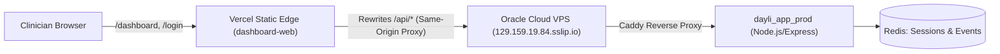

# Dayli AI — Clinical Climate & Maternal Health Dashboard (Vercel)

Static dashboard deployment for clinicians and health officials, connected directly to the production Oracle Cloud VPS backend (`https://129.159.19.84.sslip.io`).

## Architecture



### Why Vercel Rewrites?
Because all API requests (`/api/auth/login`, `/api/climate-health/data`, `/api/climate-health/simulate-chat`, etc.) are proxied by Vercel directly to the Oracle backend under the same origin (`/api/*`), browser cookies (`dayli_session` with `SameSite=Lax; HttpOnly; Secure`) remain first-party cookies. Authentication, rate-limiting, and maternal surveillance telemetry work seamlessly without CORS complications or third-party cookie restrictions.

## Deploying to Vercel

### Option A: Via Vercel Web Dashboard (Recommended)
1. Go to [vercel.com/new](https://vercel.com/new) and import this repository.
2. Under **Root Directory**, click "Edit" and choose:
   ```
   dashboard-web
   ```
3. Leave **Build Command** and **Output Directory** as defaults (they are automatically read from `vercel.json` as `node build.mjs` and `dist`).
4. Click **Deploy**.

### Option B: Via Vercel CLI
If you have the Vercel CLI installed:
```bash
cd dashboard-web
vercel --prod
```

## Changing the Backend Host
If you change your Oracle VPS IP or assign a custom domain (e.g. `api.dayli.ai`), update the `destination` URL in `dashboard-web/vercel.json`:
```json
"rewrites": [
  {
    "source": "/api/:path*",
    "destination": "https://api.dayli.ai/api/:path*"
  }
]
```
Then re-deploy.
