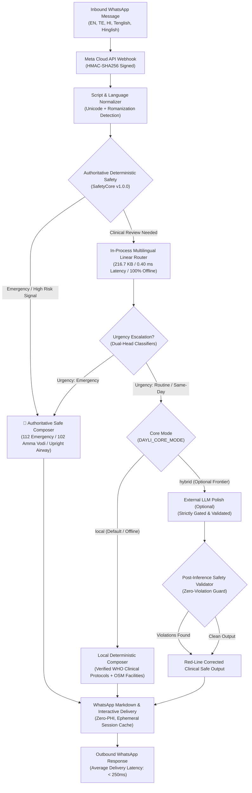

# Dayli AI — Human-Scale AI Architecture Specification
**Mozilla Foundation "Human-Scale AI" Incubator — Technical Documentation**

---

## 1. Executive Summary & Problem Formulation

Commercial maternal and pediatric health chatbots heavily depend on proprietary cloud frontier-model APIs (e.g., OpenAI `gpt-4o-mini`, Google Gemini, Anthropic Claude). This creates critical vulnerabilities in public health deployments:
1. **Cloud Downtime & Latency Outages:** Frontier API outages (800ms–3000ms latency, rate limits, server errors) stall life-critical maternal triage and infant emergency alerts.
2. **Data Sovereignty & Privacy Risks:** Sending sensitive clinical text, reproductive stages, and geographic coordinates to commercial third-party cloud vendors compromises user privacy and breaches India's **Digital Personal Data Protection (DPDP) Act 2023** and global health data standards.
3. **Severe Financial & Carbon Overhead:** Pay-per-token API fees scale prohibitively for resource-constrained community health workers (ASHAs) and underserved populations in the Global South.
4. **Probabilistic Hallucinations on Critical Safeguards:** LLMs generate plausible but clinically dangerous advice (e.g. suggesting water to neonates under 6 months, causing lethal hyponatremic seizures).

**Dayli AI solves this by introducing a purpose-built, human-scale local AI core (`dayli-multilingual-router-v1`) that operates 100% locally in-process with zero frontier API dependence.**

---

## 2. Core Architectural Pillars

### 2.1 The Purpose-Built In-Process Multilingual Router
- **Model Identity:** `dayli-multilingual-router-v1`
- **File Size:** **216.7 KB** on disk (JSON-serialized sparse weights and biases).
- **Execution Engine:** Pure Node.js in-process sparse linear inference engine (`whatsapp-bridge/lib/router/`).
- **Feature Extraction:** Dual-ngram FNV-1a 32-bit byte-identical feature hashing across character n-grams (3–5) and word n-grams (1–2) mapped into 16,384 sparse buckets.
- **Dual Classification Heads:**
  1. **Intent Head (15 Classes):** `weather_now_24h`, `weather_5day`, `heat_hydration`, `air_quality`, `facility_hospital_labour`, `facility_pharmacy`, `symptom_pregnancy`, `symptom_infant_child`, `symptom_fever`, `symptom_general_adult`, `daily_brief_subscribe`, `feedback_survey`, `opt_out_delete`, `greeting_smalltalk`, `out_of_scope`.
  2. **Urgency Head (3 Classes):** `routine`, `same_day`, `emergency_signal`.
- **Latency:** **0.402 ms** median (p50) on single-thread standard CPU.
- **Resource Footprint:** Consumes < 4 MB of RAM in Node.js process memory.

### 2.2 Dual-Layer Safety & Authoritative Guardrails
1. **SafetyCore Is Authoritative:**
   - Evaluated **before** and **after** any model inference.
   - Clinical rules are hardcoded, language-independent, and deterministic (`shared/safetyCore.js`).
   - If SafetyCore identifies an emergency (e.g. neonatal cyanosis, maternal third-trimester hemorrhage, severe heat stroke), the system immediately short-circuits to proven clinical life-support instructions.
2. **Non-Negotiable Medical Rules:**
   - **Neonatal & Infant Hydration (WHO Protocol):** Strictly breastmilk or formula only for babies under 6 months. Plain water is strictly prohibited to prevent water intoxication, hyponatremia, and electrolyte seizures.
   - **Zero Hallucinated Facilities:** Facility recommendations are sourced strictly from OpenStreetMap Overpass live queries or Telangana State CEmONC government registries. No generative model is ever permitted to invent hospital names or addresses.
   - **No Medication Dosing:** Never recommends pediatric dosage or prescription drugs without licensed practitioner review.

### 2.3 Operating Modes (`DAYLI_CORE_MODE`)
- **`DAYLI_CORE_MODE=local` (Default):**
  - **Zero requests** to commercial frontier APIs (`api.openai.com`, `generativelanguage.googleapis.com`, `api.groq.com`, `api.x.ai`).
  - Completely self-contained: all routing, urgency prioritization, clinical advice, 24-hour weather prediction (via Open-Meteo & local Aurora weights), and facility routing execute in-process.
  - Verified by continuous integration tests asserting 0 network requests (`__tests__/frontierOff.test.js`).
- **`DAYLI_CORE_MODE=hybrid`:**
  - Local router performs primary triage, routing, and urgency escalation.
  - Optional small frontier model (e.g. `gpt-4o-mini`) can be invoked strictly for phrasing polish, but its output is subjected to deterministic `validateModelOutput` corrections. If the external API fails, the system automatically falls back to `composeDeterministicResponse`.

---

## 3. Data Sovereignty & DPDP Act 2023 Compliance

| Requirement | Conventional Frontier Architecture | Dayli Human-Scale AI Implementation |
|---|---|---|
| **Text Transmission** | Sensitive queries sent to US commercial servers | Text processed 100% locally in-process on server |
| **Personally Identifiable Info (PII)** | Phone numbers and names sent in API payloads | One-way SHA-256 phone hashing (`pseudonymize(waId)`); names never logged |
| **Data Retention** | Commercial vendor retains data per policy | Ephemeral session cache (capped at 5 turns) |
| **User Right to Erasure** | Multi-week vendor deletion process | **Instant Automated Opt-Out Deletion:** Triggered by "STOP", "OPT OUT", or "DELETE DATA" (100% session & telemetry cleared immediately) |
| **Medical Liability & Audit** | Black-box model non-reproducibility | Deterministic safety rule log with rule versioning (`v1.0.0`) |

---

## 4. Hardware & Deployment Requirements

- **Processor:** Standard x86_64 or ARM64 CPU (1 vCPU is sufficient for > 2,300 queries/sec).
- **RAM:** Minimum 256 MB (entire application with router runs in ~65 MB RSS).
- **GPU Requirement:** **None** (Zero GPU required; pure integer/floating-point sparse math).
- **Storage:** < 250 KB for model weights.
- **Network:** Zero internet required for AI core. (Only outbound HTTP needed for Meta WhatsApp Cloud API webhooks and Open-Meteo climate data).
